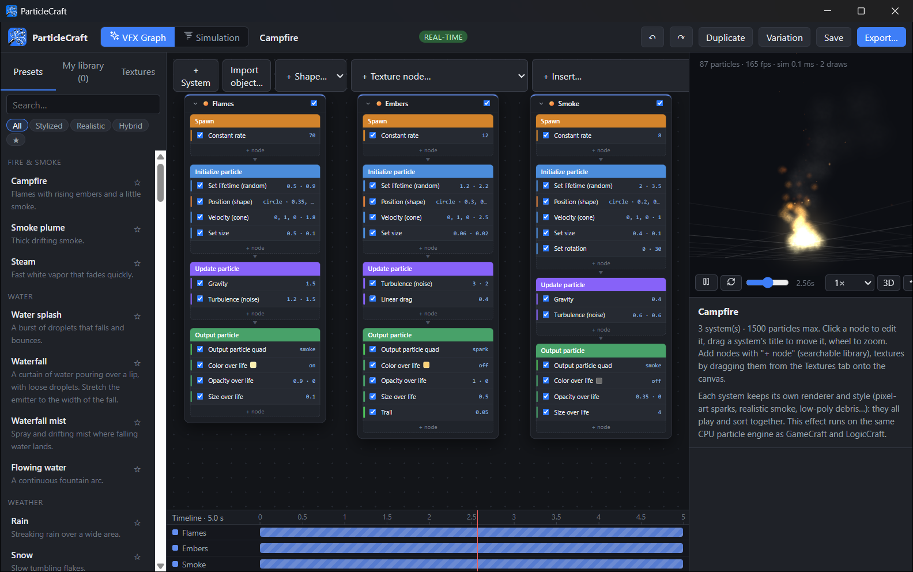
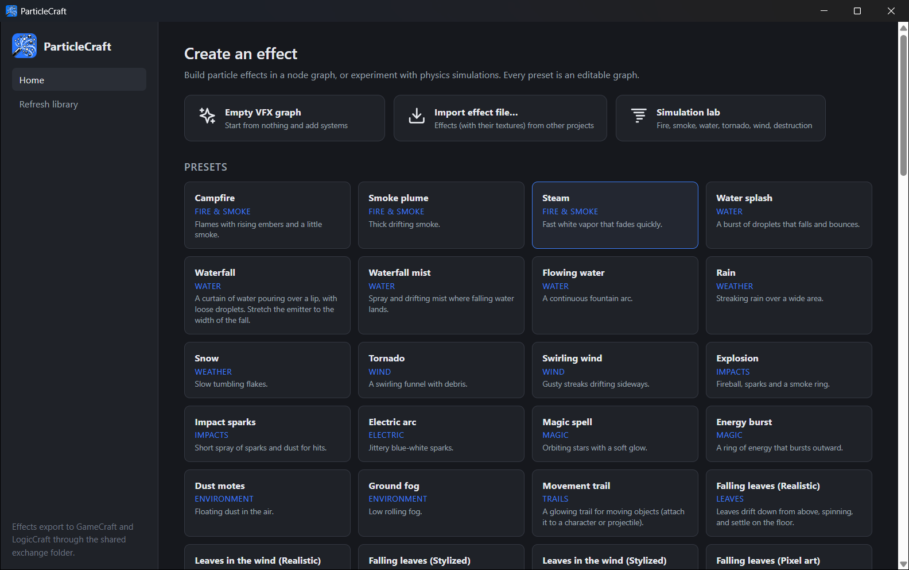

# ParticleCraft

**Node-based VFX: particle systems, textures, flipbooks and simulations for the Craft game apps.**

Node-based VFX creation for **GameCraft**, **LogicCraft**, **WorldCraft** and **SpriteCraft**: particle systems,
textures, flipbooks, materials and procedural pictures, all built from nodes — plus a physics simulation lab.



## Download

Get the latest version from the [Releases page](https://github.com/VibeCodedSoftware/ParticleCraft/releases/latest):

| File | What it is |
|---|---|
| `ParticleCraft-1.0.0-setup.exe` | **Recommended.** Installs for your Windows account (no administrator rights), adds Start menu and desktop shortcuts, and can be removed from *Settings › Apps*. |
| `ParticleCraft-1.0.0-windows-x64.zip` | Portable. Unzip anywhere and run `ParticleCraft.exe`. |

Windows 10 or 11, 64-bit. The program isn't code-signed yet, so Windows SmartScreen may warn the first
time: choose **More info › Run anyway**.

## Start

Run `ParticleCraft.exe`. Effects, textures, node groups, curves and materials are saved in
`%LOCALAPPDATA%\CraftApps\ParticleCraft`.

## The node graph

- An effect is made of **systems** (Spawn → Initialize → Update → Output). Add nodes with **+ node**: a searchable
  library of about 80 nodes in categories — emitters (point, sphere, box, cone, circle/ring, directional, random,
  path, mesh surface, image/sprite-sheet, trail), forces (gravity, wind, curl noise, noise, attraction, repulsion,
  orbit, vortex, follow target, path following, air resistance, speed limit…), physics (ground, planes, spheres,
  bounce, friction, kill volumes), events (sub-emitters on birth / death / collision / timer), curves and gradients
  over lifetime, textures, flipbooks, materials and renderers.
- Every system has its own **renderer** (billboard, stretched, horizontal, vertical, point, low-poly mesh, ribbon,
  trail, volumetric) and **style** (smooth, pixel-art, cartoon, low-poly, realistic…). Styles mix freely in one
  effect and additive and alpha systems sort together.
- **Texture nodes** make pictures: noise, Voronoi, clouds, shapes, gradients, blur, glow, kaleidoscope, polar,
  twirl, spherize, erode, dissolve, gradient map, normal map from height, make tileable, atlas, channel packing, and
  **Texture sequence** to bake animated noise into a flipbook. **Recipes** add ready-made chains.
- **Timeline** (bottom): drag systems in time, scrub the effect forwards and backwards.
- **Frames** group and collapse nodes; **Save as node group** reuses them in any effect. **+ Insert…** adds
  components, node groups, your effects or presets into the current effect. **Variation** makes a re-seeded copy.

## Textures and flipbooks

- **Textures tab**: import PNG / JPG / WebP / GIF (and sprite sheets with their JSON), folders, favourites, search,
  replace (keeps node links), sprite-sheet grid detection. **From SpriteCraft…** reads animations SpriteCraft sent.
- **Flipbook** node: stretch over the lifetime or play at a frame rate, plays per life, hold the last frame or hide,
  hold chosen frames, loop a section with intro/outro, ping-pong, reverse, random start/speed, delay, progress curve,
  frame blending, motion vectors, channel-packed sheets, custom frame order. Its panel graphs the timing.

## Export

**Export…** → *Send to the games* (GameCraft 3D effect with its pictures inside; LogicCraft / SpriteCraft animated
sprite) or *Export pictures*: PNG, PNG/JPG sequence, animated GIF, **animated WebP**, **WebM video**, sprite sheet,
**sprite sheet + JSON**, with size, frame rate, duration, range, transparency, quality and bloom.
**Download effect file** saves a `.vfx.json` that carries its textures; **Import effect file…** on the home screen
brings it into another computer or project.

## In the other apps

- **GameCraft** plays effects live: flipbooks, emission, pixel art, blend modes, sub-emitters, low-poly mesh
  particles, glow halos, flat / upright / stretched billboards, volume-lit smoke, and trails / ribbons as thin
  lines. Distortion and material maps are left out (the import dialog lists what is simplified).
- **LogicCraft** plays them in 2D, pictures tinted by the particle colour (or as an animated sprite); its logic
  blocks spawn, attach and change effects.
- **WorldCraft** previews placed effects live (position, turn, scale, world wind) and exports them into GameCraft.

## Simulation Mode

Fire and smoke, water, tornado, wind and destruction — bake to a flipbook, or convert to a real-time effect.



## Build from source

Needs [Node.js](https://nodejs.org/) 20 or later and [Rust](https://rustup.rs/) (stable, MSVC toolchain on
Windows). This repository holds the app together with the shared code it uses (`Shared/`), and the GameCraft code it reuses (`GameCraft/src`).

```powershell
powershell -ExecutionPolicy Bypass -File build.ps1
```

`build.ps1` installs the npm packages, builds the interface, compiles the desktop program and writes the
portable folder to `Windows\ParticleCraft` and the zip to `public\`. For a development server with hot reload,
run `npm run dev` in `ParticleCraft\`.

## License

ParticleCraft is licensed under **MIT OR Apache-2.0** ([LICENSE-MIT](ParticleCraft/LICENSE-MIT),
[LICENSE-APACHE](ParticleCraft/LICENSE-APACHE)). Third-party code and assets are credited in
[NOTICE.md](packaging/ParticleCraft/NOTICE.md) and [THIRD_PARTY_NOTICES.md](THIRD_PARTY_NOTICES.md).
